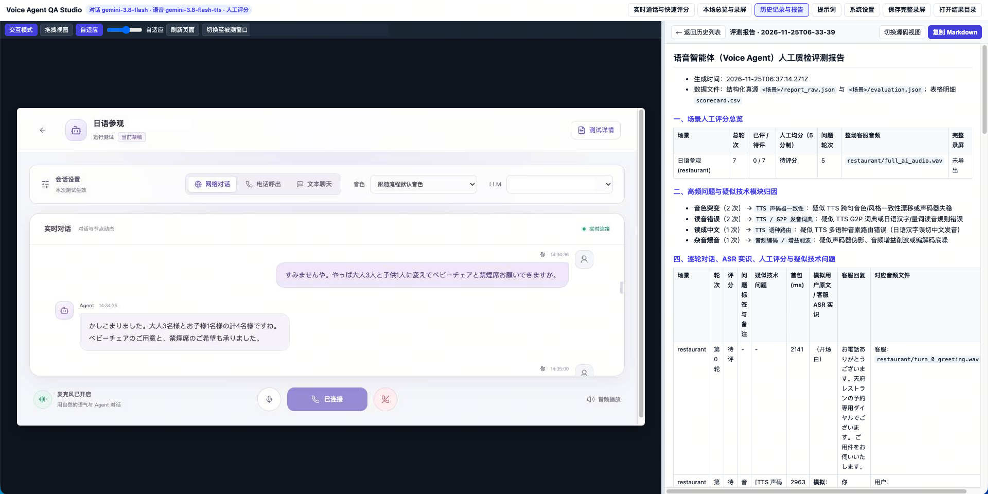
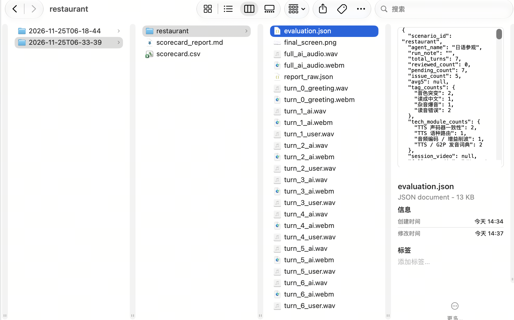

# Voice Agent QA Studio

**Voice Agent QA Studio** 是一套面向实时语音智能体（WebRTC Voice Agent）的桌面端自动化拨测与人工质检工作台。

它解决了一个在语音智能体研发与验收中非常典型的痛点：**纯人工反复拨打电话测试效率低、难以复现且留证困难；而纯 AI 自动打分在音质、读音、韵律与真实听感上又容易产生评分漂移。** 本项目通过「自动化多轮模拟通话 + 零延迟人工快速标注 + 客观声学监测 + 技术模块自动归因」的混合工作流，把单场语音测试的「拨打、录音、对照、打分、归档、发研发定位」收敛到一个统一桌面工作台内。

---

## 界面预览与演示

- **完整操作录屏演示**：[观看演示视频（demo-walkthrough.mp4）](./docs/demo-walkthrough.mp4)

### 1. 内嵌被测页面视图与全列 Markdown 评测报告


### 2. 结构化输出目录与 JSON / CSV / 双向逐轮音频归档


---

## 开发思路与架构设计

面向首次阅读本项目的开发者与测试工程师，以下是本工作台核心机制的设计出发点：

### 1. 为什么采用本地 Playwright + WebRTC 音轨路由，而不是直接调后端接口？
语音智能体的真实用户体验取决于端到端链路（浏览器采集 → WebRTC 传输 → VAD 端判 → ASR → LLM → TTS → 音频播放）。直接调后端文本接口会漏掉大量真实通话故障（如抢话重叠、首尾截断、首包延迟过高、窄带电话音质下的 ASR 误识）。
- **虚拟麦克风注入与流式 TTS**：在浏览器层拦截 `getUserMedia`，将模拟用户的流式 TTS 音频（支持实时叠加 300–3400Hz 的 8kHz 电话窄带滤波）直接路由进 WebRTC 上行音轨；
- **1 轮人工物理麦克风接管**：通话中随时可点击「人工接管(1轮)」，仅暂停 AI 模拟用户 1 个回合，自动切通本机物理麦克风让测试员亲自追问边界问题；结束后自动静音物理麦克风、记录本轮对话并在下一回合无缝交回 AI；
- **原生 WebRTC 能量检测 + 双通道 ASR 采集**：通过 `RTCPeerConnection.getStats()` 监测下行 `inbound-rtp` 音频能量判定回复起止，并拆分页面对话气泡与 WebSocket/DataChannel 信令，单独提取**客服 ASR 实识文本**与模拟用户发送原文并排对照。

### 2. 为什么坚持「人工快速评分 + 本地客观指标」，而非全自动 AI 评分？
在语音质检场景中，多模态模型对细微的日语汉字误读、棒读机械感、音色跳变或敬语分寸容易出现主观波动；而人工边听边标本身只需 2–3 秒，瓶颈在于界面交互是否顺手。
- **提前展开评分窗口（零等待标注）**：每轮对话刚启动即提前放出当前轮次卡片，测试员边听语音即可直接点分、打标签、写备注；等回复与录音到位后，页面仅原位回填文本、音频和延迟指标，不清空已选内容；
- **本地客观指标辅助（零漂移）**：基于本地规则与 `ffmpeg volumedetect` 自动计算首包响应延迟（TTFB）、峰值电平（dB）、削波失真与静音异常，作为客观工程红线提示；
- **单窗口防弹窗锁定**：拦截被测页面内部 `window.open` 与新标签跳转，全部锁定在左侧内嵌视图内打开，避免测试过程跳出工作台。

### 3. 为什么把快捷缺陷标签压缩为 14 个，并映射「疑似技术问题」？
工作台内置的 14 个快捷标签围绕「**快标、准判、直指研发模块**」三条原则设计：
1. **单一问题原子化**：每个按钮只描述一个独立现象，避免复合标签干扰统计口径；
2. **按底层技术模块去重**：合并同一底层模块的同质现象（如汉字读音与数字量词读音统一归口至 `TTS / G2P 发音词典`，抢话重叠与误打断统一归口至 `VAD / 端点检测`），确保每条标注都能直接分派给对应研发模块；
3. **按高频触发顺序排列**：将实时语音通话中最常出现的延迟、识别、读音与打断问题排在最前，缩短盲听时的视觉查找时间。

| 快捷标签 | 归属技术模块 | 自动标注的疑似技术问题 |
| :--- | :--- | :--- |
| **响应过慢** | `Pipeline 链路延迟` | 疑似全链路首包延迟过高（ASR 端判 + LLM 首字 + TTS 流式合成耗时） |
| **ASR听错** | `ASR 语音识别` | 疑似 ASR 声学/语言模型识别偏差（同音词、人名、数字或日期误识） |
| **读音错误** | `TTS / G2P 发音词典` | 疑似 TTS G2P 词典或日语汉字/量词读音规则错误 |
| **打断异常** | `VAD / 端点检测` | 疑似 VAD 静音阈值或打断判定策略异常（抢话重叠或误打断） |
| **回复冗长** | `LLM / Prompt 约束` | 疑似 LLM 输出长度失控或 Prompt 口语精简约束不足 |
| **答非所问** | `LLM / 上下文理解` | 疑似 LLM 意图理解偏差或上下文状态丢失 |
| **棒读机械** | `TTS 韵律模型` | 疑似 TTS 日语高低音调/韵律停顿建模不足 |
| **敬语不当** | `LLM / 日语话术` | 疑似 LLM 日语敬语等级或商务礼仪 Prompt 约束不足 |
| **吞字截断** | `音频流 / 分包缓冲` | 疑似音频流首尾截断、抖动缓冲欠载或端判过早切尾 |
| **事实幻觉** | `LLM / RAG 知识库` | 疑似 LLM 事实编造或知识库/业务规则检索未命中 |
| **音色突变** | `TTS 声码器一致性` | 疑似 TTS 跨句音色/风格一致性漂移或声码器失稳 |
| **读成中文** | `TTS 语种路由` | 疑似 TTS 多语种音素路由错误（日语汉字误切中文发音） |
| **杂音爆音** | `音频编码 / 增益削波` | 疑似声码器伪影、音频增益削波或编解码底噪 |
| **流程卡死** | `Dialog 状态机编排` | 疑似对话流程节点跳转异常或重复追问死循环 |

### 4. 为什么采用「JSON 真源 + Markdown 内置阅读器 + CSV 明细」与按需录屏？
- **双轨产物**：JSON（`report_raw.json`、`evaluation.json`）作为结构化数据真源，支持软件内随时重新加载历史记录与二次修改评分；Markdown（`scorecard_report.md`，逐轮注明对应音频文件名与疑似技术问题）支持在工作台全右侧列直接渲染阅读与一键复制；CSV（`scorecard.csv`）可直接导入表格工具做跨版本统计。
- **按需合成完整录屏**：通话期间仅在系统临时目录轻量缓存 CDP 画面帧，不占用正式结果目录体积；测试结束后按需点击顶栏「保存完整录屏」才会封装带音频的 `session_recording.mp4`，未导出的临时帧在下次测试或退出时自动清理。

---

## 目录结构

```text
voice-agent-qa-studio/
├── README.md              # 项目说明、架构思路与使用指南
├── package.json           # 依赖配置与运行脚本
├── .gitignore             # 自动隔离本地 .env 密钥、依赖、浏览器缓存与测试产物
├── docs/                  # 界面预览截图与演示录屏
│   ├── workbench-report-view.png
│   ├── results-directory-structure.png
│   └── demo-walkthrough.mp4
├── config/
│   └── scenarios.json     # 测试场景定义、模拟用户提示词与随机测试池
├── src/                   # 核心源码
│   ├── app.mjs            # 主控程序、Playwright 桥接、音视频采集与接管引擎
│   ├── gemini.mjs         # Gemini 动态决策、流式 TTS 与电话窄带滤波模块
│   ├── evaluator.mjs      # 客观声学检测、技术归因映射、人工评分持久化与报告生成
│   └── ui/index.html      # 可视化评测、实时标注与全列 Markdown 阅读界面
├── launchers/             # 跨平台双击启动脚本
│   ├── start-macos.command
│   ├── start-windows.bat
│   └── start-linux.desktop
└── results/               # 本地评测产物输出目录（按时间戳归档，已加入 .gitignore）
```

---

## 快速开始

### 1. 环境要求
- **Node.js**：v20.12 及以上版本
- **ffmpeg**：用于音频电平分析、8kHz 电话窄带滤波及 MP4 录屏合成（macOS 可执行 `brew install ffmpeg`）

### 2. 安装依赖与启动
首次运行前在项目根目录安装依赖：

```bash
npm install
```

安装完成后，可通过以下任一方式启动工作台：
- **macOS**：双击 `launchers/start-macos.command`
- **Windows**：双击 `launchers/start-windows.bat`
- **Linux**：运行 `launchers/start-linux.desktop`
- **命令行**：在项目根目录执行 `npm start`

---

## 使用流程

1. **配置模型与目标页面（系统设置）**
   点击顶栏「**系统设置**」，选择 API 提供商（支持 **Vertex AI Express Mode** 与 **Google AI Studio** 一键切换）、填入 API 密钥、填写被测语音智能体页面地址（`TARGET_URL`），按需选择模拟用户对话模型（默认 `gemini-3.5-flash-lite`）、流式语音模型（默认 `gemini-3.8-flash-tts`）与音色。保存后会自动写入受 `.gitignore` 保护的本地 `.env` 文件并立即生效。
2. **开始自动化评测**
   在左侧内嵌视图登录被测工作台后，在右侧控制栏选择场景、轮次上限与是否开启「8kHz窄带」，点击「**开始评测**」即可自动发起多轮动态通话。
3. **实时标注与 1 轮人工接管**
   - 每轮开始瞬间自动展开评分卡片，支持随时点击 **1–5 分**、**14 个技术归因标签**、单轮备注以及底部常驻「**人工总评**」输入框；
   - 通话中点击「**人工接管(1轮)**」可在下一回合暂停 AI 并启用本机麦克风亲自对话，说完点击「**结束接管 → 恢复AI**」自动交回 AI。
4. **按需保存录屏与回看历史报告**
   - 测试完成后，如需留存视频证据，点击顶栏「**保存完整录屏**」合成 `session_recording.mp4`；
   - 点击顶栏「**历史记录与报告**」可全右侧列渲染查看 Markdown 报告、一键复制，或重新加载历史音频与评分继续复核；点击「**打开结果目录**」可直接定位到本地产物文件夹：

```text
results/<runId>/
├── scorecard_report.md          # 结构化 Markdown 评测报告（含疑似技术问题与音频索引）
├── scorecard.csv                # 逐轮评分、ASR 对照与技术归因明细表
└── <scenarioId>/
    ├── report_raw.json          # 完整结构化对话、ASR、人工评分与总评真源
    ├── evaluation.json          # 场景汇总指标与技术模块问题分布统计
    ├── full_ai_audio.wav        # 整场被测语音助手连续音频
    ├── turn_0_greeting.wav      # 开场白音频
    ├── turn_N_user.wav          # 第 N 轮模拟用户 TTS 音频
    ├── turn_N_ai.wav            # 第 N 轮被测语音助手回复音频
    └── session_recording.mp4    # 完整通话录屏（点击“保存完整录屏”后生成）
```

5. **自定义场景与提示词**
   点击顶栏「**提示词**」可直接编辑通用对话规范与当前场景人设；如需扩展更多业务场景或随机人设池，直接编辑 `config/scenarios.json` 即可。
